# Architecture — teachMe

| | |
|---|---|
| **Status** | Draft v0.3 (Flutter + Express + PostgreSQL, local-only) |
| **Related** | [PRD](PRD.md) · [TRD](TRD.md) · [Design](DESIGN.md) |

---

## 1. Architecture Goals

| Goal | Implication |
|---|---|
| Ship the MVP fast with a small team | Monorepo, one mobile app + one API process, no extra infrastructure |
| Run anywhere on a laptop | PostgreSQL in Docker Compose, local disk, in-process scheduler, mock payment gateway |
| Money and scheduling must be correct | Single transactional state machine, conditional slot claim, idempotent settlement |
| Two different role experiences | Role-aware shells, routing guards, and theme accents in Flutter |
| Easy to grow later | Provider seams (payment, notification, storage) and portable schema |
| Safe by default | Server-side authorization, hashed secrets, audited transitions |

## 2. System Context (C4 — Level 1)

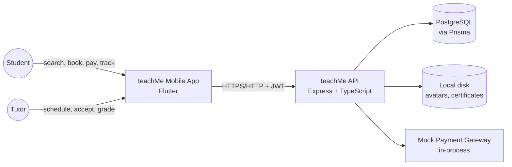

## 3. Local Runtime Topology (Containers — Level 2)

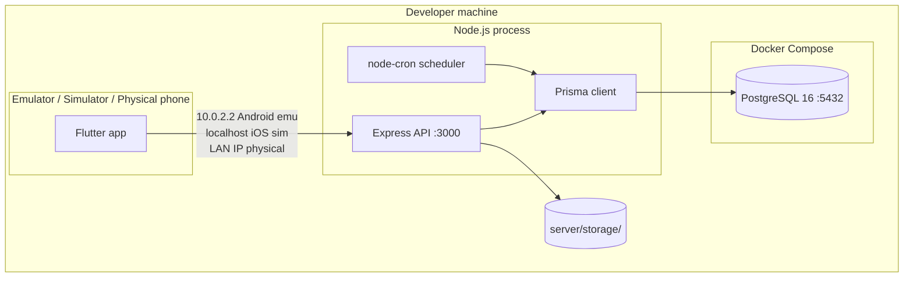

- **One server process** hosts HTTP routes and the scheduler; there is no queue, cache, or message broker.
- **PostgreSQL** is the only containerized piece (`docker compose up -d db`). Booking safety relies on an atomic conditional update inside a transaction, so correctness does not depend on the deployment.
- Moving later to a hosted environment means: point `DATABASE_URL` at a managed PostgreSQL, swap the mock provider for a real gateway, and move storage to object storage. No structural change.

## 4. Mobile Architecture (Flutter)

### 4.1 Layers

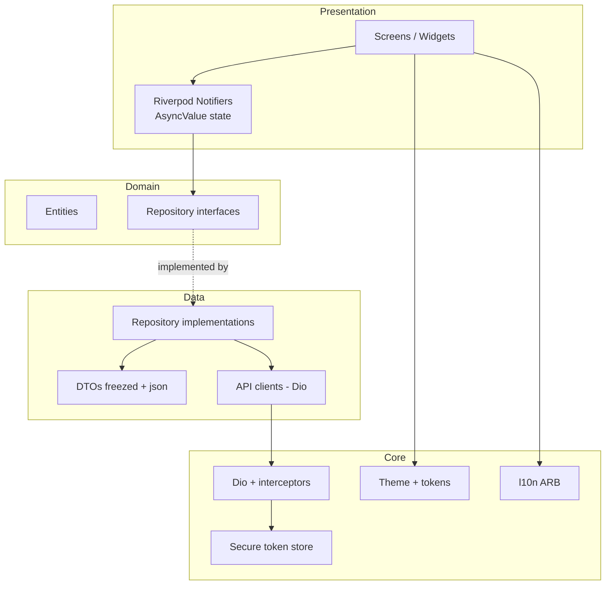

Rules:
1. Widgets never call Dio directly; they watch Riverpod providers.
2. Domain has no Flutter or Dio imports.
3. DTO ↔ entity mapping lives in the data layer.
4. Each feature owns its folder: `features/<name>/{data,domain,presentation}`.

### 4.2 Role-aware shells and routing

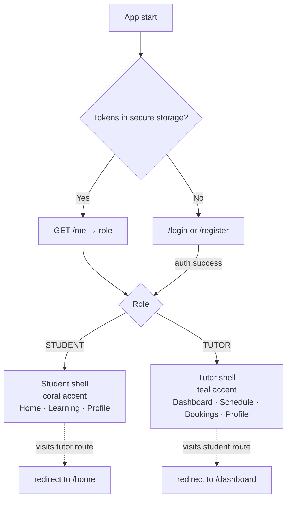

- The router redirect is a **UX guard**. The API enforces the same rules independently.
- Each shell wraps its subtree with `Theme(data: buildTheme(brightness, role: …))`, so every widget picks up the right accent via `RoleAccent` without conditionals.

### 4.3 Networking and session handling

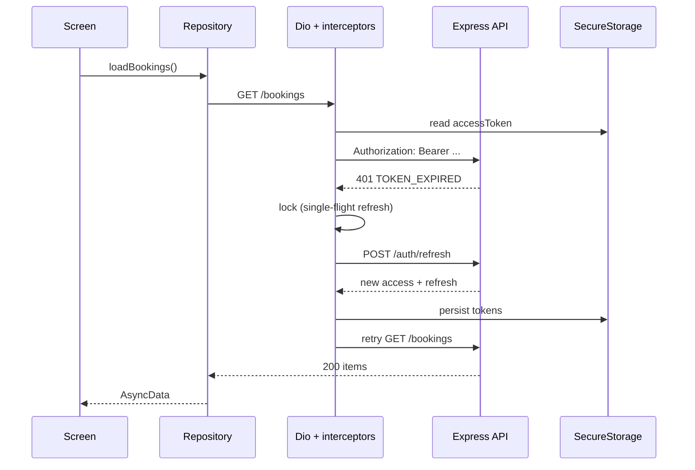

If refresh fails (revoked or expired) the interceptor clears storage and the auth state flips to signed-out, which triggers the router redirect to `/login`.

## 5. Backend Architecture (Express)

### 5.1 Module view

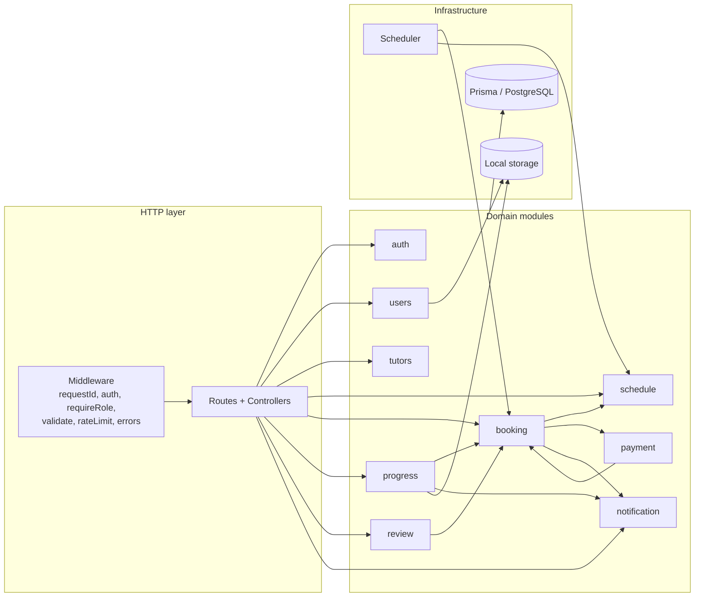

Rules:
1. Controller → service → repository. Controllers validate (Zod) and map responses only.
2. Services own business rules, policies, and transactions.
3. Modules call each other through service functions, never each other's repositories.
4. The booking state machine is the **only** code allowed to change `Booking.status`.
5. Dependencies are one-directional (enforced with `eslint-plugin-boundaries` or a simple import-lint rule).

### 5.2 Request lifecycle

```
request → requestId → pino-http → helmet → cors → json parser → rateLimit
        → authenticate (JWT) → requireRole → validate(zod) → controller
        → service (policy + transaction) → repository (Prisma)
        → response  |  AppError → errorHandler → error envelope
```

## 6. Key Flows

### 6.1 Register and login

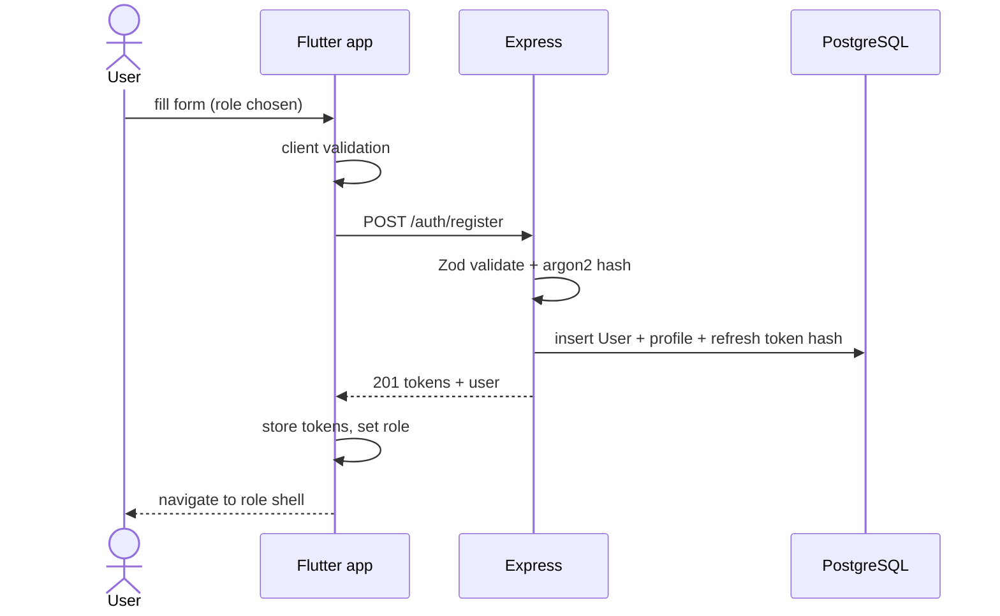

### 6.2 Booking → acceptance → payment (local mock)

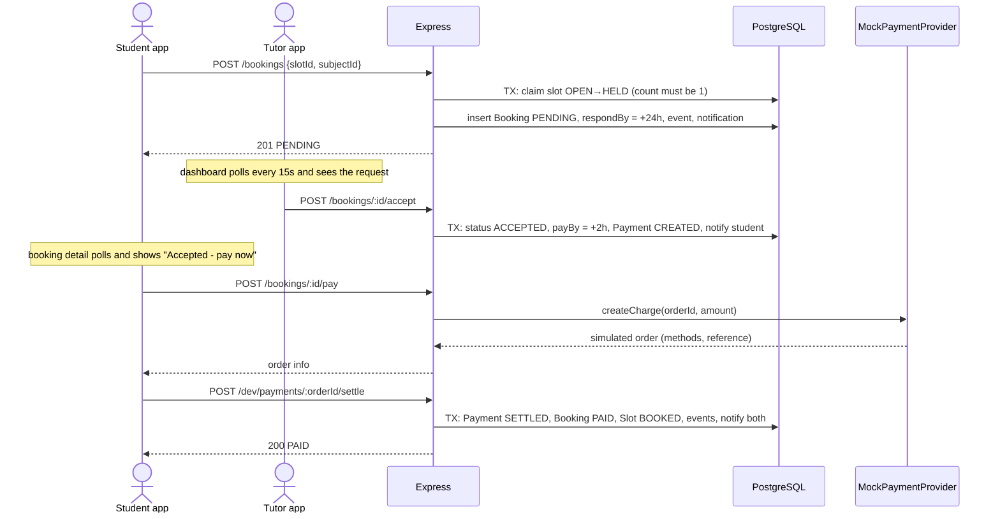

### 6.3 Grading → progress → certificate

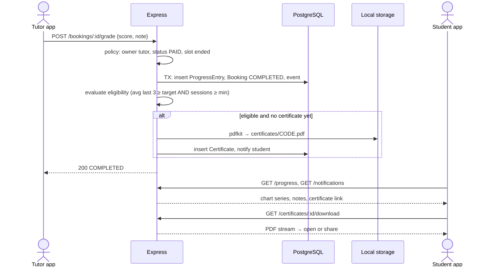

### 6.4 Expiry sweeper

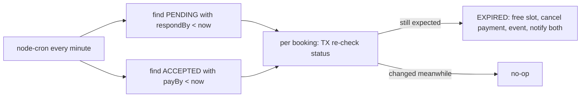

## 7. Data Architecture

- **PostgreSQL** is the system of record locally; the ERD is in [TRD §4](TRD.md#4-data-model).
- **Concurrency:** `slot.updateMany({ where: { id, status: "OPEN" }, data: { status: "HELD" } })` inside an interactive transaction; `count !== 1` → `409 SLOT_UNAVAILABLE`. A unique index on `Booking.slotId` is the backstop.
- **Auditability:** `BookingEvent` rows for every transition.
- **Notifications** are rows in `Notification`; the app reads them via polling (no push).
- **Time:** UTC on the wire and in storage; conversion on the device.
- **Money:** integer IDR; prices and fees snapshotted on the booking.
- **Seed/reset:** deterministic seed script makes demos and tests repeatable.

## 8. Cross-Cutting Concerns

| Concern | Approach |
|---|---|
| **AuthN** | JWT access (15m) + rotating hashed refresh tokens; argon2id |
| **AuthZ** | Router guard (UX) → `requireRole` → ownership policies in services |
| **Validation** | Zod on the server; mirrored rules in Flutter forms; server field errors map back to inputs |
| **Errors** | `AppError` → single error envelope → `ApiError` in the app → localized message |
| **Idempotency** | Optional `Idempotency-Key`; settlement idempotent on `orderId` |
| **Logging** | pino JSON logs with `requestId`, `userId`, `bookingId` |
| **Config** | Zod-validated `env.ts` on the server; `--dart-define` in the app |
| **i18n** | ARB files, Indonesian default, English secondary |
| **Theming** | `ThemeData` + `RoleAccent` extension; light/dark; role-based accent |
| **Freshness** | Pull-to-refresh + polling (15s detail/dashboard, 30s notification count) |

## 9. Security Architecture (Local)

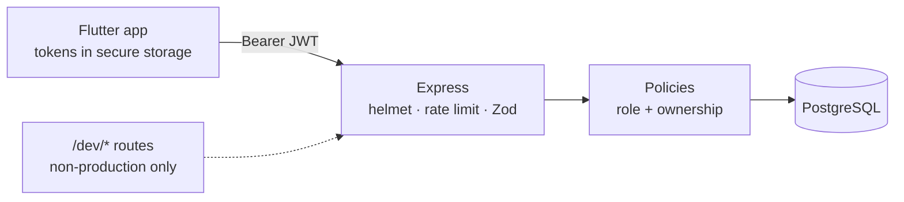

- Trust boundary is the API: everything from the app is untrusted until validated and authorized.
- Tokens never leave secure storage and are never logged.
- Dev-only routes exist only when `NODE_ENV !== production`.
- Cleartext HTTP is allowed in **debug builds only** for local development.

## 10. Local Development Setup

| Item | Decision |
|---|---|
| Processes | 1 API (`npm run dev`) + Flutter app (`flutter run`) + PostgreSQL container |
| Database | PostgreSQL container, data in Docker volume `teachme_pgdata` (`docker-compose.yml` at repo root) |
| Files | `server/storage/` (git-ignored) |
| Reset | `npm run db:reset` |
| Device access | Android emulator `10.0.2.2`, iOS simulator `localhost`, phone via LAN IP |
| Config | `server/.env`; `--dart-define=API_BASE_URL=…` |
| Deployment | Out of scope for now |

## 11. Architecture Decision Records (summary)

| ADR | Decision | Status | Trade-off |
|---|---|---|---|
| 001 | Flutter for mobile (Android + iOS) | Accepted | One codebase and rich animation; Dart ecosystem |
| 002 | Express + TypeScript modular monolith | Accepted | Simple and fast to build; boundaries enforced by convention/lint |
| 003 | PostgreSQL + Prisma (local via Docker Compose) | Accepted | Production-grade integrity, native enums/JSON, CHECK constraints; needs Docker or a local install |
| 004 | Riverpod for state | Accepted | Testable and scoped; learning curve vs `setState`/Provider |
| 005 | `go_router` with role shells | Accepted | Declarative guards; UX-only, API still authoritative |
| 006 | JWT access + rotating refresh tokens | Accepted | Mobile-friendly; requires refresh handling and single-flight lock |
| 007 | In-process `node-cron` sweeper (query-based) | Accepted | No queue to run; single-instance only |
| 008 | Slot **hold** at request time | Accepted | Prevents double booking; tutor slot blocked until response/expiry |
| 009 | Payment only **after** acceptance | Accepted | No refunds for rejected requests; one extra step for students |
| 010 | Mock payment behind `PaymentProvider` | Accepted | Full flow testable offline; must replace before real money |
| 011 | Polling instead of push/websocket | Accepted | Simple; slight latency and battery cost |
| 012 | Role accent via `ThemeExtension` | Accepted | One widget library, two identities |
| 013 | Conditional update (not `FOR UPDATE`) for slot claim | Accepted | One atomic statement, simple to reason about; row locks remain an option for multi-row workflows |

## 12. Evolution Path

1. **Hosted environment:** managed PostgreSQL, object storage, HTTPS, secret management, CI/CD.
2. **Real payments:** Midtrans/Xendit provider + signed webhook route; refunds in the state machine.
3. **Push notifications:** FCM/APNs replacing polling; email via provider.
4. **Realtime:** WebSocket/SSE for live status badges.
5. **Search:** PostgreSQL full-text, then a dedicated engine if needed.
6. **Chat and video:** in-app messaging, then session links.
7. **More clients:** Flutter web/desktop or an admin dashboard on the same API.
