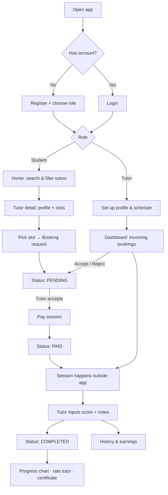

# Product Requirements Document (PRD) — teachMe

| | |
|---|---|
| **Status** | Draft v0.2 (Flutter + Express, local-only) |
| **Owner** | Product / Design Engineering |
| **Last updated** | 2026-10-20 |
| **Related** | [TRD](TRD.md) · [Architecture](ARCHITECTURE.md) · [Design](DESIGN.md) |

---

## 1. Overview

teachMe is a private-tutoring marketplace. Students find tutors by subject, book a slot, pay for the session, and track their progress. Tutors manage their schedule, accept bookings, and record scores and notes after every session.

Sessions themselves happen **outside the app** (offline or via any video tool). teachMe owns discovery, scheduling, payment, and progress tracking.

**Delivery format:** a **Flutter mobile app** (Android + iOS) backed by an **Express REST API**. For now everything runs **locally** (no cloud deployment); payment is simulated by a built-in mock gateway so the full booking flow can be exercised end to end.

## 2. Problem Statement

- Students struggle to find trustworthy, affordable tutors and rely on word-of-mouth or scattered social media posts.
- Young tutors manage schedules, payments, and student notes in chat apps and spreadsheets.
- Students and parents have no visible evidence of learning progress, so motivation and trust drop.

## 3. Goals & Non-Goals

### Goals
1. Make it possible to go from "I need help with Physics" to a paid, confirmed session in under 3 minutes.
2. Give tutors a lightweight tool to run their tutoring as a small business (schedule, bookings, earnings).
3. Make learning progress visible and motivating (charts, targets, certificates).
4. Deliver a modern, playful experience that feels native to Gen Z.

### Non-Goals (MVP)
- In-app video/audio sessions or chat
- Group classes, subscriptions, or packages
- Automated payouts to tutors (earnings ledger only)
- Tutor identity/credential verification workflow (manual flag only)
- Web or desktop clients (mobile only; Flutter could target them later)
- Production deployment, push notifications, and email delivery (local-only for now)
- Real payment gateway integration (simulated gateway for now)
- Parent accounts

## 4. Target Users & Personas

### Persona A — Student ("Alya", 16, high school)
- Wants a Math tutor before exams, has a limited budget, is on her phone all day.
- Cares about: price, ratings, quick booking, seeing improvement.
- Frustrations: unclear availability, payment friction, no proof of progress.

### Persona B — Tutor ("Bima", 21, university student)
- Teaches 3–5 students per week to earn side income.
- Cares about: control of his schedule, not chasing payments, simple tracking.
- Frustrations: double bookings, manual tracking, no-shows without payment.

## 5. User Roles

| Role | Accent | Summary |
|---|---|---|
| **Student** | Coral / orange | Discovers tutors, books, pays, tracks progress |
| **Tutor** ("admin" of own space) | Teal | Manages profile, schedule, bookings, grading, earnings |

A user has exactly one role, chosen at registration. Role-specific navigation and permissions are mandatory (see FR-AUTH-04).

## 6. User Flow

## 7. Scope & Screens

| # | Screen | Role | Release |
|---|---|---|---|
| 1 | Login / Register (+ role choice) | Both | MVP |
| 2 | Student Home — search & tutor list | Student | MVP |
| 3 | Tutor Detail — profile, schedule, book button | Student | MVP |
| 4 | Booking & Payment | Student | MVP |
| 5 | History & Progress (chart, certificate) | Student | MVP |
| 6 | Tutor Dashboard — stats & incoming bookings | Tutor | MVP |
| 7 | Manage Schedule | Tutor | MVP |
| 8 | Input Score & Notes | Tutor | MVP |

## 8. Functional Requirements & User Stories

Priority: **P0** = MVP must-have, **P1** = MVP should-have, **P2** = post-MVP.

### 8.1 Authentication & Authorization (AUTH)

| ID | Requirement | Pri |
|---|---|---|
| FR-AUTH-01 | Users register with name, email, password, and role (Student/Tutor). | P0 |
| FR-AUTH-02 | Users log in with email + password; failed attempts show friendly inline errors. | P0 |
| FR-AUTH-03 | Client and server validation: valid email, password ≥ 8 chars with letter + number, required fields. | P0 |
| FR-AUTH-04 | Role-based access: Student pages are inaccessible to Tutors and vice versa; navigation differs by role. | P0 |
| FR-AUTH-05 | Password reset (local mode: dev-only reset code shown in the server console). Email verification deferred. | P2 |
| FR-AUTH-06 | Optional Google sign-in. | P2 |

**Acceptance criteria (FR-AUTH-01..04)**
- Given I submit the register form with an existing email, then I see "Email already in use" and no account is created.
- Given I am logged in as a Tutor, when I open a Student URL directly, then I am redirected to my dashboard (403 on API calls).
- Given I submit invalid fields, then each field shows an inline, supportive message and focus moves to the first error.

### 8.2 Tutor Discovery (DISC)

| ID | Requirement | Pri |
|---|---|---|
| FR-DISC-01 | Student can search tutors by keyword (name or subject). | P0 |
| FR-DISC-02 | Filter by subject, price range, minimum rating; sort by rating, price, newest. | P0 |
| FR-DISC-03 | Tutor card shows avatar, name, subjects, rating, hourly price, next available slot. | P0 |
| FR-DISC-04 | Tutor detail shows bio, subjects, rating + reviews, and an available-slot picker. | P0 |
| FR-DISC-05 | Empty and loading states are friendly (skeletons, illustration). | P1 |

**Acceptance criteria**
- Given I filter "Physics" + "≤ Rp100.000", then only matching tutors appear, and the filter state is reflected in the URL.
- Given a tutor has no free slots, the card shows "No slots yet" and the booking CTA is disabled.

### 8.3 Booking & Payment (BOOK)

| ID | Requirement | Pri |
|---|---|---|
| FR-BOOK-01 | Student selects a slot and subject, adds an optional note, and submits a booking request. | P0 |
| FR-BOOK-02 | The slot is held on request so it cannot be double-booked. | P0 |
| FR-BOOK-03 | Tutor accepts or rejects within 24h; otherwise the request expires and the slot is released. | P0 |
| FR-BOOK-04 | After acceptance, Student pays within 2h. Local mode uses a simulated gateway (e-wallet / virtual account / QRIS options, "simulate payment"). | P0 |
| FR-BOOK-05 | Booking status is always visible as a badge: Pending, Accepted, Paid, Completed (plus Rejected, Cancelled, Expired). | P0 |
| FR-BOOK-06 | Student can cancel before payment; cancellation after payment is P2 (refund policy TBD). | P1 |
| FR-BOOK-07 | Both parties get an in-app notification (inbox + unread badge) on every status change. Push and email are deferred. | P1 |

**Status lifecycle**

| Status | Meaning | Who moves it forward |
|---|---|---|
| Pending | Request sent, waiting for tutor | Tutor (accept/reject) |
| Accepted | Tutor confirmed, waiting for payment | Student (pays) |
| Paid | Payment settled, session scheduled | Tutor (grades after session) |
| Completed | Session done, score recorded | — |

### 8.4 Tutor Management (TUT)

| ID | Requirement | Pri |
|---|---|---|
| FR-TUT-01 | Tutor edits profile: photo, bio, subjects, hourly rate per subject. | P0 |
| FR-TUT-02 | Tutor manages weekly availability (create/edit/delete time ranges) and one-off blocked dates. | P0 |
| FR-TUT-03 | Tutor dashboard: this-week sessions, pending requests, earnings this month, average rating. | P0 |
| FR-TUT-04 | Tutor accepts/rejects incoming requests from the dashboard with optional rejection reason. | P0 |
| FR-TUT-05 | Tutor views teaching history and earnings (gross, platform fee, net). | P1 |

### 8.5 Progress, Rating & Certificate (PROG)

| ID | Requirement | Pri |
|---|---|---|
| FR-PROG-01 | After a paid session, Tutor inputs a score (0–100) and a progress note. Submitting marks the booking Completed. | P0 |
| FR-PROG-02 | Student sees a line chart of scores per session, filterable by subject/tutor, with tutor notes. | P0 |
| FR-PROG-03 | Student sets a learning target (target score and minimum sessions) per tutor-subject. | P1 |
| FR-PROG-04 | When the target is reached, a certificate is generated; Student can download a PDF. | P1 |
| FR-PROG-05 | Certificates have a public verification page via a unique code. | P2 |
| FR-PROG-06 | Student rates (1–5) and optionally reviews a Tutor once per completed booking. | P0 |

**Certificate rule (default):** average of the last 3 scores ≥ target score **and** completed sessions ≥ minimum sessions.

### 8.6 Cross-cutting

| ID | Requirement | Pri |
|---|---|---|
| FR-X-01 | Light and dark mode, following system preference with manual override. | P1 |
| FR-X-02 | Indonesian (default) and English UI copy structure (i18n-ready). | P2 |
| FR-X-03 | All money displayed in IDR with thousands separators; all times shown in the viewer's timezone (default Asia/Jakarta). | P0 |

## 9. Non-Functional Requirements

| Area | Requirement |
|---|---|
| Performance | Cold start < 3s on a mid-range phone; 60fps scrolling and animations; list endpoints p95 < 300ms on local server |
| Availability | Not applicable while local-only; target defined when deployed |
| Security | OWASP ASVS L1 where applicable; hashed passwords; token auth with refresh; server-side authorization; signed webhooks when a real gateway is added |
| Privacy | Collect minimal personal data; many users are minors → clear consent and data-deletion path |
| Accessibility | WCAG 2.2 AA principles: contrast, 48dp touch targets, screen-reader semantics, reduced-motion support |
| Responsiveness | Phones first (360dp+), tablets adapt (navigation rail, wider grids) |
| Reliability | Payment webhooks idempotent; no double-booking under concurrency |
| Observability | Structured console logs, audit trail for booking/payment transitions |

## 10. Success Metrics

| Metric | MVP target (first 90 days) |
|---|---|
| Visitor → registered student conversion | ≥ 15% |
| Search → booking request conversion | ≥ 8% |
| Accepted → paid conversion | ≥ 70% |
| Tutor response rate within 24h | ≥ 85% |
| Completed sessions with score recorded | ≥ 90% |
| Repeat booking (same student, 30 days) | ≥ 35% |
| Average tutor rating | ≥ 4.5 |

## 11. Assumptions

1. Sessions occur outside the platform; the tutor is trusted to mark them complete by grading.
2. One slot = one 60-minute session in MVP (configurable duration is P2).
3. Platform charges a 10% commission, deducted from the tutor's earnings.
4. Payments are simulated by a mock gateway in local mode; a real gateway (e.g. Midtrans) plugs in later behind the same interface.
5. Users under 17 register with the understanding that a guardian consents (terms flow to be defined by legal).

## 12. Risks & Mitigations

| Risk | Impact | Mitigation |
|---|---|---|
| Off-platform payment leakage | Revenue loss | Value-add features (progress, certificates, reviews) only exist for platform sessions |
| Tutors don't grade sessions | Broken progress data | Reminders; grade prompt on dashboard; streak badge |
| Minors' safety | Trust / legal | No in-app chat in MVP; report button; basic tutor verification flag |
| Double-booking | Bad experience | Slot hold + DB-level unique constraint |
| Low tutor supply at launch | Empty marketplace | Seed with campus tutor communities |

## 13. Release Plan

| Milestone | Contents |
|---|---|
| **M0 — Foundation** (wk 1–2) | Repo, design tokens, auth, role routing |
| **M1 — Supply side** (wk 3–4) | Tutor profile, schedule CRUD, dashboard shell |
| **M2 — Demand side** (wk 5–6) | Discovery, tutor detail, booking request |
| **M3 — Money** (wk 7–8) | Accept/reject, payment, webhooks, status badges |
| **M4 — Progress** (wk 9–10) | Grading, progress chart, rating |
| **M5 — Polish & Beta** (wk 11–12) | Certificates, dark mode, notifications, a11y, QA |

## 14. Open Questions

1. Refund and cancellation policy after payment?
2. Do tutors need to pass a verification before listing?
3. Is a trial/first-session discount desired?
4. Payout cadence and method for tutors (post-MVP)?
5. What is the minimum age and consent mechanism for students?
6. Should session duration be flexible (30/60/90 min)?
7. Which payment gateway and hosting do we pick when we leave local-only mode?
8. Do we need push notifications (FCM/APNs) before the first public beta?
