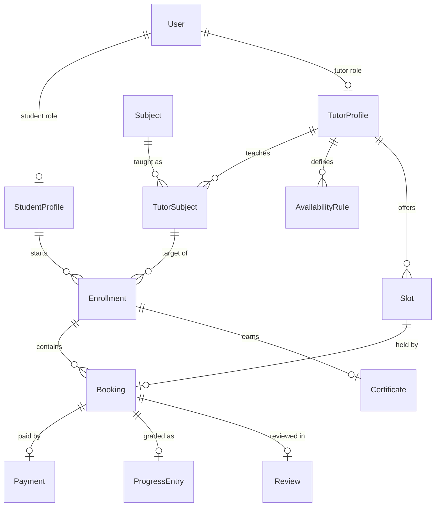

# Seed Data — teachMe

| | |
|---|---|
| **Status** | Current |
| **Script** | [`teachme-be/prisma/seed.ts`](../teachme-be/prisma/seed.ts) |
| **Related** | [PRD](PRD.md) · [TRD](TRD.md) · [Architecture](ARCHITECTURE.md) · [Design](DESIGN.md) |

---

## 1. Overview

The seed script populates the database with a deterministic, realistic dataset so that the full
booking lifecycle (`PENDING → ACCEPTED → PAID → COMPLETED`) can be exercised end to end without
any manual setup.

Every write is an **idempotent `upsert`** keyed on a natural unique column (slug, email,
`tutorId + subjectId`, `tutorId + startsAt`). Running `npm run seed` more than once is safe: it
creates missing rows and leaves existing ones untouched.

The database is hosted on **Supabase PostgreSQL**; no local Docker container is required.

---

## 2. Prerequisites

| Requirement | Notes |
|---|---|
| Node.js ≥ 20 | matches `teachme-be/package.json` |
| `.env` present | `DATABASE_URL` (pooler, `:6543`) and `DIRECT_URL` (session, `:5432`) |
| Dependencies installed | `npm install` inside `teachme-be/` |
| Schema pushed | run `npm run db:push` (or `db:migrate`) before seeding |

Example `.env` (values are illustrative):

```env
DATABASE_URL="postgresql://postgres.<ref>:<password>@aws-0-<region>.pooler.supabase.com:6543/postgres?pgbouncer=true"
DIRECT_URL="postgresql://postgres.<ref>:<password>@aws-0-<region>.pooler.supabase.com:5432/postgres"
```

---

## 3. How to run

```bash
cd teachme-be

npm install
npm run db:push      # sync tables with prisma/schema.prisma
npm run seed         # insert demo data (idempotent)
npm run dev          # start the API on http://localhost:3000
```

Reset everything (drops all rows, re-syncs, re-seeds):

```bash
npm run db:reset
```

Browse the data visually:

```bash
npm run db:studio
```

The script logs its progress step by step:

```
[seed] Starting...
[seed] Connected.
[seed] 8 subjects seeded.
[seed] Student created: student@teachme.dev
[seed] Tutor 1 created: tutor@teachme.dev
[seed] 6 tutor-subjects seeded.
[seed] 15 availability rules seeded.
[seed] 60 slots generated.
[seed] Seed completed successfully!
```

---

## 4. Seeded data inventory

| Entity | Count | Description |
|---|---|---|
| `Subject` | 8 | Reference subjects available for filtering and enrollment |
| `User` (Student) | 1 | Alya Ramadhani, SMA |
| `User` (Tutor) | 3 | Bima Prasetya, Sarah Wijaya, Rafi Hartono — all verified |
| `TutorSubject` | 6 | per-subject hourly pricing per tutor |
| `AvailabilityRule` | 15 | 5 weekday rules per tutor (16:00–20:00) |
| `Slot` (`OPEN`) | 60 | next 7 days, 60-minute blocks |
| `Enrollment` | 1 | Alya → Matematika (Bima), target 80, min 5 sessions |
| `Booking` | 1 | `COMPLETED` sample with linked payment, progress, review |
| `Payment` | 1 | `SETTLED` payment for the sample booking |
| `ProgressEntry` | 1 | score `85` |
| `Review` | 1 | rating `5` |
| `Certificate` | 0 | generated automatically once a target is reached |

### 4.1 Subjects

| Name | Slug |
|---|---|
| Matematika | `matematika` |
| Fisika | `fisika` |
| Kimia | `kimia` |
| Bahasa Inggris | `bahasa-inggris` |
| Biologi | `biologi` |
| Sejarah | `sejarah` |
| Informatika | `informatika` |
| Ekonomi | `ekonomi` |

### 4.2 Users

| Name | Email | Role | Profile |
|---|---|---|---|
| Alya Ramadhani | `student@teachme.dev` | `STUDENT` | `schoolLevel: SMA` |
| Bima Prasetya | `tutor@teachme.dev` | `TUTOR` | bio: Mahasiswa Teknik UI semester 6 · verified |
| Sarah Wijaya | `sarah@teachme.dev` | `TUTOR` | bio: Lulusan ITB jurusan Kimia · verified |
| Rafi Hartono | `rafi@teachme.dev` | `TUTOR` | bio: Guru les berpengalaman 5 tahun · verified |

### 4.3 Tutor subjects & pricing

| Tutor | Subject | Price (IDR / 60 min) |
|---|---|---|
| Bima Prasetya | Matematika | 75.000 |
| Bima Prasetya | Fisika | 80.000 |
| Sarah Wijaya | Kimia | 90.000 |
| Sarah Wijaya | Biologi | 85.000 |
| Rafi Hartono | Bahasa Inggris | 70.000 |
| Rafi Hartono | Ekonomi | 65.000 |

### 4.4 Availability rules

Each tutor receives the same weekly pattern (weekday index: `0` = Sunday … `6` = Saturday):

| Weekday | Index | Window (minutes) | Window (clock) |
|---|---|---|---|
| Monday | 1 | 960 → 1200 | 16:00 → 20:00 |
| Tuesday | 2 | 960 → 1200 | 16:00 → 20:00 |
| Wednesday | 3 | 960 → 1200 | 16:00 → 20:00 |
| Thursday | 4 | 960 → 1200 | 16:00 → 20:00 |
| Friday | 5 | 960 → 1200 | 16:00 → 20:00 |

`startMinute` / `endMinute` are minutes from midnight, evaluated in the tutor's timezone
(`Asia/Jakarta`).

### 4.5 Generated slots

For each tutor, the seed materializes 60-minute `OPEN` slots for the **next 7 days** that fall
inside the weekday rules and are still in the future. Slots are unique on `(tutorId, startsAt)`, so
re-running the seed never duplicates them.

| Slot status | Meaning |
|---|---|
| `OPEN` | claimable by a student |
| `HELD` | temporarily reserved during a booking request |
| `BOOKED` | paid and confirmed |
| `CLOSED` | manually closed by the tutor |

### 4.6 Sample completed booking

One full historical booking exists so the Progress screen has data on first launch:

| Field | Value |
|---|---|
| Student | Alya Ramadhani |
| Tutor | Bima Prasetya |
| Subject | Matematika |
| Price / fee | 75.000 / 7.500 (10% platform fee) |
| Slot | 3 days ago, 16:00–17:00 (`BOOKED`) |
| Status | `COMPLETED` |
| Payment | `SETTLED` (provider `mock`) |
| Progress | score `85` — "Bagus! Pemahaman aljabar sudah meningkat." |
| Review | 5★ — "Pak Bima menjelaskan dengan sangat jelas dan sabar." |

---

## 5. Demo credentials

All demo accounts share the same password.

| Role | Email | Password |
|---|---|---|
| Student | `student@teachme.dev` | `Password123!` |
| Tutor | `tutor@teachme.dev` | `Password123!` |
| Tutor | `sarah@teachme.dev` | `Password123!` |
| Tutor | `rafi@teachme.dev` | `Password123!` |

Obtain a token pair:

```bash
curl -X POST http://localhost:3000/api/v1/auth/login \
  -H 'Content-Type: application/json' \
  -d '{"email":"student@teachme.dev","password":"Password123!"}'
```

---

## 6. Entity relationships



The seed wires these links so that:

```
student@teachme.dev
  └─ StudentProfile (SMA)
       └─ Enrollment (Matematika · target 80 · min 5)
            └─ Booking (COMPLETED)
                 ├─ Payment (SETTLED)
                 ├─ ProgressEntry (85)
                 └─ Review (5★)
```

---

## 7. Verifying the seed

### Prisma Studio

```bash
cd teachme-be && npm run db:studio
```

Open tables `Subject`, `User`, `TutorSubject`, `AvailabilityRule`, `Slot`, `Booking` and confirm
the counts in §4.

### API smoke checks

```bash
curl http://localhost:3000/api/v1/health
# {"status":"ok"}

STUDENT=$(curl -s -X POST http://localhost:3000/api/v1/auth/login \
  -H 'Content-Type: application/json' \
  -d '{"email":"student@teachme.dev","password":"Password123!"}' \
  | python3 -c 'import sys,json;print(json.load(sys.stdin)["accessToken"])')

curl -s http://localhost:3000/api/v1/subjects -H "Authorization: Bearer $STUDENT"
curl -s "http://localhost:3000/api/v1/tutors" -H "Authorization: Bearer $STUDENT"
curl -s "http://localhost:3000/api/v1/enrollments" -H "Authorization: Bearer $STUDENT"
```

### Postman

Import `postman/teachMe.postman_collection.json` and `postman/local.postman_environment.json`,
then run the **E2E Happy Path** folder to exercise the full lifecycle with the seeded accounts.

---

## 8. Postman collection

| File | Purpose |
|---|---|
| [`postman/teachMe.postman_collection.json`](../postman/teachMe.postman_collection.json) | All API requests grouped by module + a runnable E2E folder |
| [`postman/local.postman_environment.json`](../postman/local.postman_environment.json) | `baseUrl` and runtime variables |

### Environment variables

| Variable | Initial value | Set by |
|---|---|---|
| `baseUrl` | `http://localhost:3000/api/v1` | — |
| `studentToken` | — | Login (Student) |
| `tutorToken` | — | Login (Tutor) |
| `refreshToken` | — | Login (Student) |
| `userId` | — | Login (Student) |
| `subjectId` | — | Subjects → first item |
| `tutorId` | — | Search Tutors → first item |
| `slotId` | — | Tutor Slots → first `OPEN` |
| `bookingId` | — | Create Booking |
| `orderId` | — | Pay Booking |
| `enrollmentId` | — | Get Enrollments |
| `certificateId` | — | Get Enrollments (when earned) |
| `ruleId` | — | Create Availability Rule |
| `exceptionId` | — | Create Availability Exception |

### E2E Happy Path order

```
Login (Student)
Login (Tutor)
GET  /subjects
GET  /tutors?subjectId={{subjectId}}
GET  /tutors/{{tutorId}}/slots?from=…&to=…
POST /bookings                      → PENDING  (saves bookingId)
POST /bookings/{{bookingId}}/accept → ACCEPTED (tutor)
POST /bookings/{{bookingId}}/pay    → order    (saves orderId)
POST /dev/payments/{{orderId}}/settle → PAID
POST /bookings/{{bookingId}}/grade  → COMPLETED (tutor, score 88)
GET  /enrollments                   → saves enrollmentId
GET  /progress?enrollmentId={{enrollmentId}}
```

Each request embeds a captured **sample response** in the collection for reference.

---

## 9. Idempotency & reset

- **Idempotent:** every insert is an `upsert` on a natural unique key, so re-running `npm run seed`
  converges to the same state without duplicates or errors.
- **Safe to re-run after code changes** — new subjects/tutors are added without touching existing
  bookings.
- **Full reset:** `npm run db:reset` wipes all rows (`prisma db push --force-reset`), then re-runs
  the seed. Use this when you want a clean, reproducible demo state.
- **Production warning:** the seed targets development data only. Never point `DATABASE_URL` at a
  production database when running it.